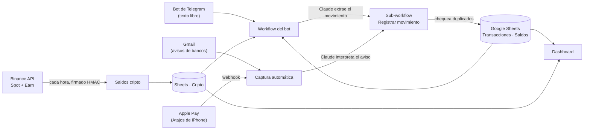

# Finanzas personales automatizadas con n8n + Claude

Sistema para llevar mis finanzas personales sin cargar planillas a mano. Le escribo a un bot de Telegram "Gasté 5000 en verdulería con Mercado Pago" y queda registrado. Los avisos de bancos y los pagos con Apple Pay se cargan solos, los saldos se actualizan con cada movimiento y un dashboard muestra todo, incluida la cripto en Binance.

Todo corre en **n8n Cloud**. **Claude** (Anthropic) interpreta el lenguaje natural y **Google Sheets** guarda los datos.



## Qué hace

| Workflow | Disparador | Qué resuelve |
|---|---|---|
| [Telegram: registro de gastos e ingresos](workflows/telegram-gastos-ingresos.json) | Mensaje al bot | Claude clasifica el mensaje: **movimiento**, **consulta** ("¿cuánto gasté en salidas este mes?") o **saldos** ("¿cuánto tengo?"). n8n hace las cuentas leyendo la hoja, no la IA. |
| [Registrar movimiento](workflows/finanzas-registrar-movimiento.sdk.ts) (sub-workflow) | Lo llaman el bot y la captura | Único punto de guardado. Detecta posibles **duplicados** y pregunta con botones *Agregar / Descartar*, guarda la fila, actualiza el saldo de su moneda y confirma por Telegram. |
| [Captura automática](workflows/finanzas-captura-automatica.sdk.ts) | Gmail cada 6 h + webhook de Apple Pay | Lee avisos de Mercado Pago, Revolut, Santander y Supervielle, y las transacciones de Wallet que manda un Atajo del iPhone. Ignora promos, códigos y transferencias entre cuentas propias. |
| [Saldos cripto Binance](workflows/finanzas-binance-cripto.sdk.ts) | Cada hora | Lee Spot + Simple Earn (flexible y bloqueado) con una API **de solo lectura**, valúa cada activo en USD y reescribe la pestaña `Cripto`. |
| [WhatsApp: registro de gastos](workflows/whatsapp-gastos-ingresos.json) | WhatsApp Cloud API | Primera versión del bot. Quedó reemplazada por Telegram cuando Meta restringió la cuenta Business. |
| [WhatsApp: respuesta automática con IA](workflows/whatsapp-respuesta-automatica-ia.json) | Webhook de WAHA (self-hosted) | "Modo ausente": un agente Claude con memoria por chat responde mensajes privados. Se activa con `/ausente on`. |

## Decisiones de diseño

- **La IA interpreta, el código calcula.** Claude solo convierte texto libre en un JSON (tipo, monto, moneda, categoría, fecha o período). Los totales, saldos y conversiones los hace JavaScript, así no hay números inventados.
- **Parser defensivo** a la salida del LLM: limpia bloques de código, normaliza montos ("15.000,50"), monedas y fechas. Si algo no cierra, lo marca como inválido en vez de guardar basura.
- **Monedas separadas.** ARS, USD y EUR nunca se suman entre sí. La cripto se valúa en USD y se suma solo a los dólares.
- **Duplicados:** mismo monto y moneda, y además fecha a ±1 día o mismo comercio. Así un aviso del banco no se carga dos veces si ya lo anoté a mano.
- **Binance sin secretos en el workflow:** la firma HMAC-SHA256 se hace con el nodo Crypto leyendo el secret desde una credencial de n8n. Evita contar dos veces lo de Earn (`LDxxx` en Spot) sin perder tokens reales como `LDO`.
- **Fallos visibles:** reintentos en todas las llamadas externas, salidas de error conectadas y aviso por Telegram. Si Binance falla, la hoja conserva el último dato bueno.
- **Por qué Sheets y no una base de datos:** se puede corregir a mano desde el celular y el dashboard la lee directo.

## Stack

n8n Cloud (Workflow SDK en TypeScript) · Claude Haiku · Google Sheets · Telegram Bot API · Gmail · Binance REST API · Atajos de iOS · Docker (n8n + WAHA para desarrollo local)

## Estructura

```
workflows/   Workflows: JSON para importar y fuentes .sdk.ts (Workflow SDK de n8n)
snippets/    Código de nodos Code destacado
n8n-local/   docker-compose para correr n8n + WAHA en local
```

## Cómo usarlo

1. **Hoja de cálculo:** crear un Google Sheet con estas pestañas:
   - `Transacciones` (Fecha, Tipo, Monto, Moneda, Categoría, Descripción, Método de Pago, Notas).
   - `Saldos` (Moneda, Saldo, Actualizado, Notas), con una fila por moneda.
   - `Cripto` (Activo, Spot, Earn, Cantidad, Precio USD, Total USD, Actualizado).
2. **Credenciales en n8n:** Google Sheets, Telegram, Gmail y Anthropic. Para Binance, una *Header Auth* `X-MBX-APIKEY` y una *Crypto* con el secret, con una API key de **solo lectura**.
3. **Importar:** los `.json` se pegan en el lienzo de n8n con Ctrl+V. Los `.sdk.ts` se crean con el Workflow SDK de n8n o el servidor MCP de n8n.
4. **Reemplazar los marcadores** antes de activar:

   | Marcador | Qué poner |
   |---|---|
   | `TU_GOOGLE_SHEET_ID` | ID de tu planilla |
   | `TU_CHAT_ID_TELEGRAM` | Tu chat ID (el bot solo responde a ese chat) |
   | `TU_CREDENCIAL_SHEETS`, `TU_CREDENCIAL_TELEGRAM` | Tus credenciales (o reasignarlas en cada nodo) |
   | `TU_ID_SUBWORKFLOW_REGISTRAR` | ID del sub-workflow *Registrar movimiento* una vez creado |
   | `REEMPLAZAR` | Credenciales de WAHA y Anthropic (workflow de respuesta automática) |

5. **Local (opcional):** `cd n8n-local`, copiar `.env.example` como `.env`, completarlo y correr `docker compose up -d`.

## Seguridad

- No hay claves en el repo: todo vive en las credenciales cifradas de n8n.
- La API de Binance es de solo lectura (sin trading ni retiros).
- El bot ignora cualquier chat que no sea el configurado.
- `.env`, `.mcp.json` y las configuraciones locales están en `.gitignore`.

## Licencia

[MIT](LICENSE)
